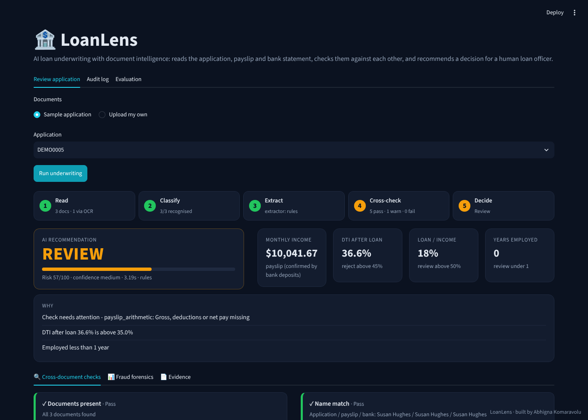
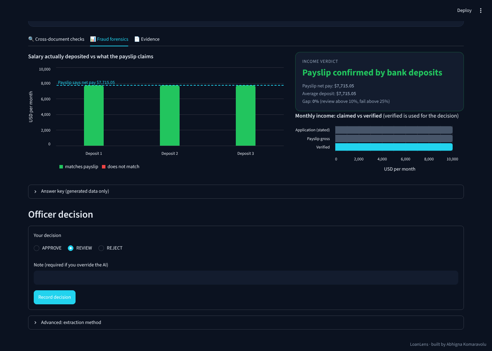
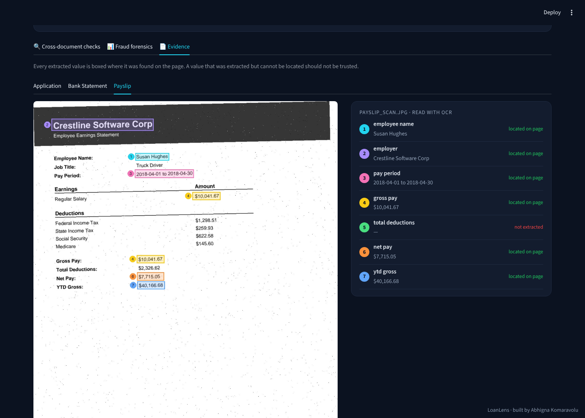
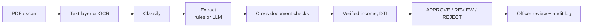

# LoanLens: Document Intelligence for Loan Underwriting


LoanLens reads a personal-loan applicant's **application form, payslip and bank statement**,
extracts the key fields, cross-checks the documents against each other to catch income fraud,
computes affordability and recommends **APPROVE / REVIEW / REJECT**, with written reasons, for
a human loan officer to confirm.

**Live demo:** https://loanlens-ai-loan-underwriting-with-document-intelligence-uhwpy.streamlit.app/



## What the officer sees

| Fraud forensics | Evidence highlighting |
|---|---|
|  |  |
| Salary actually deposited, month by month, against what the payslip claims. Inflated payslips stand out as red bars far below the claimed line. | Every extracted value is boxed and numbered where it was found on the page, so no number has to be trusted blindly. Values that were extracted but can't be located are flagged. |

## The problem

| | |
|---|---|
| **User** | Loan officer at a retail bank / NBFC |
| **Pain** | 30–60 min of manual document checking per application; inflated-income fraud slips through |
| **Outcome** | Faster decisions, fraud caught, lower defaults among approved loans, full audit trail |
| **AI's role** | Read unstructured documents. Rules make money decisions. A human makes the final call. |

Full scope: [docs/SCOPE.md](docs/SCOPE.md) · Design: [docs/ARCHITECTURE.md](docs/ARCHITECTURE.md)

## How it works



**Checks performed**
- Same person on all documents
- Payslip arithmetic: gross − deductions = net
- Employer matches across application, payslip letterhead and payroll deposits
- Payslip income vs stated income
- **Payslip net pay vs salary actually deposited in the bank** (main fraud signal; when it fails,
  true income is re-estimated from deposits)

**Credit policy** (in `src/loanlens/config.py`): DTI after the new loan above 45% → reject,
above 35% → review; loan above 50% of annual income → review; under 1 year employed → review.

## Data: real numbers, generated documents

- **Real:** borrower income, existing debt (via DTI), loan amount, term, EMI and **actual
  repayment outcome** from the public [Lending Club dataset](https://www.kaggle.com/datasets/wordsforthewise/lending-club)
  (2007–2018). Sample: 1,000 repaid + 1,000 defaulted loans.
- **Generated:** the documents themselves, because real payslips and bank statements are
  private by law. Names and employers are fictional.
- **Stress tests built in:** 20% injected fraud (3 types), 25% scanned payslips, and 30% of
  documents in a **layout the regex rules have never seen**.

## Results

Evaluated on **real Lending Club borrowers** (documents generated from their records; 23% with
injected fraud, 25% scanned payslips, 30% in a layout the regex rules have never seen).
The rules-vs-Gemini comparison uses the same 60 applications (17 of them fraudulent).

| Metric | Rules baseline | Gemini (free tier) |
|---|---|---|
| Field accuracy, seen layout | 99.5% | 97.3% |
| Field accuracy, **unseen layout** | **0.0%** | **97.2%** |
| Fraud recall | 88.2% | **100%** |
| Fraud precision | 55.6% | **100%** |
| False fraud alarms on clean applications | 12 | **0** |
| Risk score AUC vs real defaults | 0.522 | 0.629 |
| Seconds per application | 1.6 | 12.1 |

**Rules baseline on all 300 applications:** 100% document classification, 99.6% field accuracy
on the seen layout and 0% on the unseen one, 94.7% on scanned payslips, fraud recall 78.3%.
None of the 69 fraudulent applications was auto-approved: every missed case went to human
review.

**What this shows**
- Template rules are fast and near-perfect on a known layout, but collapse on a new one, and
  their misreads (e.g. reading "PAY SLIP" as the employer) become false fraud alarms.
- The LLM extractor generalises to the unseen layout with no code changes and removed every
  false alarm, at about 8x the latency.
- Default prediction is modest (AUC 0.63). Lending Club had already approved these borrowers,
  and the documents carry only income, debt and employment, not credit history.

**Known weakness:** LLM accuracy on *scanned* payslips was about 75% (names, employer and pay
period copied with OCR spacing errors). The OCR cleanup used by the rules now runs on every
extractor's output; this has not been re-measured with Gemini yet.

Reproduce: `python evals/run_eval.py` (rules, all) ·
`python evals/run_eval.py --method gemini --limit 60 --sleep 7` ·
`python evals/run_eval.py --limit 60 --tag first60`

## Quick start

### 1. Install (Windows PowerShell)
```powershell
git clone https://github.com/k-Abhigna/LoanLens-AI-loan-underwriting-with-document-intelligence.git
cd LoanLens-AI-loan-underwriting-with-document-intelligence
python -m venv .venv
.venv\Scripts\activate
pip install -r requirements.txt
pip install -e .
```
On Mac/Linux use `source .venv/bin/activate`. If PowerShell blocks activation, run
`Set-ExecutionPolicy -Scope CurrentUser RemoteSigned` once.

### 2. Try it on demo data (2 minutes, no downloads)
```powershell
python scripts/make_demo_data.py
python -m loanlens.generate.build_dataset --input data/demo/demo_borrowers.csv --limit 40
streamlit run app/streamlit_app.py
```
Demo borrowers are random, so their "real outcome" numbers mean nothing. Use step 3 for real results.

### 3. Run on real Lending Club data
1. Download **Lending Club** by *wordsforthewise* from Kaggle and put
   `accepted_2007_to_2018Q4.csv.gz` in `data/raw/`.
2. Build the sample and documents, then evaluate:
```powershell
python scripts/make_sample.py
python -m loanlens.generate.build_dataset --limit 300
python evals/run_eval.py
```
Results are written to `evals/results/`.

### 4. Use a free LLM extractor
Copy `.env.example` to `.env`, then either:
- **Gemini:** create a free key at https://aistudio.google.com/apikey and set `GEMINI_API_KEY`.
  If the default model name is retired, set `GEMINI_MODEL` to a current free model.
- **Ollama:** install from https://ollama.com and run `ollama pull qwen2.5:3b`.

```powershell
python evals/run_eval.py --method gemini --limit 100 --sleep 7
python -m loanlens.pipeline data/generated/<application_id> --method ollama
```
`--sleep` keeps you inside the free tier's rate limit (3 LLM calls per application).

### 5. Tests
```powershell
pytest -q
```

## Project structure

```
loanlens/
├── app/streamlit_app.py      # loan officer review UI + audit log + eval results
├── src/loanlens/
│   ├── generate/             # real borrower → documents, fraud injection, scans, layouts
│   ├── extract/              # OCR/PDF text, classifier, regex + LLM extractors
│   ├── checks.py             # cross-document verification
│   ├── decide.py             # credit policy engine
│   ├── pipeline.py           # end-to-end CLI
│   └── audit.py              # decision log
├── evals/run_eval.py         # accuracy, fraud, real-outcome evaluation
├── scripts/                  # Lending Club sampling, demo data
├── tests/                    # pytest suite (runs in CI)
└── docs/                     # scope and architecture
```

## Design decisions

- **AI reads, code decides.** LLMs only convert documents into a validated schema; lending
  decisions are deterministic, auditable rules.
- **Missing ≠ fraud.** An unreadable field sends the case to a human instead of flagging fraud.
  Evaluation showed the opposite design produced false fraud alarms.
- **Bank deposits are the anchor.** A payslip is easy to edit; salary actually received isn't.
- **Human in the loop.** The officer confirms every decision; overrides need a written reason
  and are logged.

## Limitations & next steps

- Documents are US-format and generated; the next step is Indian formats (Form 16, salary slips
  with PF/ESI, Aadhaar/PAN KYC).
- Default prediction is limited because documents carry only income, debt and employment.
  Credit bureau data would be needed for a strong risk model.
- Vision-LLM extraction directly from images (instead of OCR → LLM) is not yet compared.
- The rules-vs-LLM comparison covers 60 applications; a larger run would tighten the numbers.

## License
MIT
