# Architecture

```mermaid
flowchart LR
    subgraph Data["Data (offline)"]
        LC[(Lending Club<br/>real borrowers + outcomes)] --> S[make_sample.py<br/>balanced 1000/1000]
        S --> G[build_dataset.py<br/>PDFs, scans, fraud, 2 layouts]
    end

    subgraph Pipeline["Pipeline (per application)"]
        D[Documents<br/>PDF / JPG] --> T{Text layer?}
        T -- yes --> P[pdfplumber]
        T -- no --> O[RapidOCR<br/>+ line rebuild]
        P --> C[Classifier]
        O --> C
        C --> E{Extractor}
        E -- rules --> R[Regex baseline]
        E -- gemini / ollama --> L[LLM → JSON<br/>Pydantic validate + 1 retry]
        R --> X[Cross-document checks]
        L --> X
        X --> V[Verified income<br/>DTI, LTI]
        V --> DE[Policy engine<br/>APPROVE / REVIEW / REJECT]
    end

    G --> D
    DE --> UI[Streamlit review UI]
    UI --> A[(Audit log<br/>AI + human decisions)]
    DE --> EV[evals/run_eval.py]
```

## Modules

| Module | Responsibility |
|---|---|
| `generate/profile.py` | Real borrower row → document facts; fraud injection |
| `generate/pdfs.py` | Render application form, payslip, bank statement (layouts A and B) |
| `generate/scan.py` | Turn a PDF into a noisy, tilted "phone scan" |
| `extract/text.py` | PDF text or OCR text with reading-order reconstruction |
| `extract/classify.py` | Document type from keywords |
| `extract/rules.py` | Regex extraction baseline, OCR-noise tolerant |
| `extract/llm.py` | Gemini / Ollama JSON extraction with schema validation and retry |
| `checks.py` | Name, employer, arithmetic and income consistency checks; verified income |
| `decide.py` | Credit policy → decision, reasons, risk score, confidence |
| `audit.py` | Append-only log of AI recommendations and officer decisions |
| `pipeline.py` | Ties it all together; CLI |

## Key design decisions

1. **AI reads, code decides.** LLMs only turn unstructured documents into a fixed schema. All
   money decisions are deterministic rules a credit team can audit.
2. **Missing ≠ fraud.** If a field can't be read, the check is `warn` (human review), not
   `fail` (fraud). This was found through evaluation: treating missing values as mismatches
   produced false fraud alarms on clean applications.
3. **The bank statement is the anchor.** Payslips are easy to forge; salary actually deposited
   is harder. When the payslip disagrees with deposits, income is re-estimated from deposits.
4. **Evaluate on unseen layouts.** Regex rules score near 100% on the layout they were written
   for and fail on a new one. Layout B measures how each extractor generalises.
5. **Balanced outcomes.** The sample is 50% repaid / 50% defaulted, so "approve everyone" can't
   look good.
